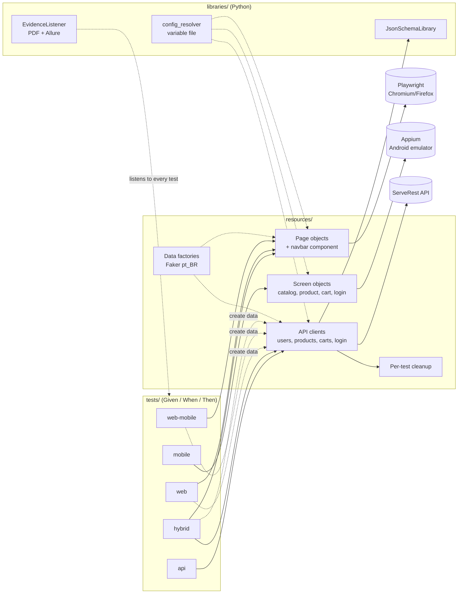

# Robot Framework Test Automation

[](https://github.com/ricardho/robot-framework-test-automation/actions/workflows/tests.yml)
[](https://ricardho.github.io/robot-framework-test-automation/)


Test automation framework in **Robot Framework** covering the four layers most QA jobs ask for:
**REST API**, **web (desktop)**, **web mobile** (device emulation), **hybrid API + UI** and
**native Android** (Appium), written as native Given/When/Then, run in parallel, with
**per-test PDF evidence**, **Allure** report published to GitHub Pages and secrets kept out of git.

**Live test report:** https://ricardho.github.io/robot-framework-test-automation/
(Robot Framework log: [`/robot/log.html`](https://ricardho.github.io/robot-framework-test-automation/robot/log.html))

> Sister project with the same architecture in Java (Selenium, JUnit 5, Cucumber, RestAssured):
> [selenium-java-test-automation](https://github.com/ricardho/selenium-java-test-automation)

## Systems under test

| Layer | Application |
|---|---|
| API | [ServeRest](https://serverest.dev): users, login (JWT), products, carts |
| Web / web mobile | [ServeRest front-end](https://front.serverest.dev): customer store and admin area |
| Native Android | [Sauce Labs My Demo App](https://github.com/saucelabs/my-demo-app-android) 2.3.0 |

ServeRest has an API **and** a front-end over the same data, which makes real hybrid tests possible:
create data through the API, check it in the UI, and the other way round.

## Tech stack

| Purpose | Tool |
|---|---|
| Language / dependencies | Python 3.14 + [uv](https://docs.astral.sh/uv/) (`pyproject.toml` + `uv.lock`) |
| Framework | Robot Framework 7.5, native Given/When/Then (no Cucumber needed) |
| Web UI | [Browser Library](https://robotframework-browser.org/) (Playwright): Chromium, Firefox, WebKit |
| Web mobile | Playwright device emulation (`iPhone 14`, `Pixel 7`) |
| Native mobile | AppiumLibrary + Appium + UiAutomator2, Screen Objects |
| API | RequestsLibrary + JSON Schema (draft 2020-12) via a small Python library |
| Test data | FakerLibrary (`pt_BR`) |
| Parallelism | Pabot (`--testlevelsplit`) |
| Reports | Robot log/report + Allure (`allure-robotframework`) on GitHub Pages |
| Evidence | Python listener + fpdf2: one PDF per test, modes `failure` / `always` / `steps` |
| Lint / format | Robocop |
| Secrets | `.env` (git-ignored) + GitHub repository secrets + Gitleaks |
| CI | GitHub Actions (+ Android emulator job) |

## Architecture



```
config/
  settings.toml          versioned, non-sensitive defaults
  common.args            options shared by every robot/pabot run (pythonpath, listeners, output)
libraries/
  config_resolver.py     variable file: --variable > env var > .env > settings.toml > default
  ConfigLibrary.py       "Get Required Config": secrets as robot.api.types.Secret (shown as <secret>)
  JsonSchemaLibrary.py   "Json Should Match Schema" with cross-file $ref (urn:serverest:*)
  EvidenceListener.py    listener v3: screenshots, HTTP capture (masked), PDF, Allure attachments
  evidence/              PDF writer (fpdf2) and masking
resources/
  api/                   one client per endpoint + session, cleanup, project admin account
  web/                   browser lifecycle, page objects, navbar component, token login
  mobile/                app lifecycle + screen objects
  data/                  test data factories
  schemas/               JSON Schemas of the API responses
tests/
  api/ web/ web-mobile/ hybrid/ mobile/
scripts/                 helper scripts (download of the Android app)
.github/workflows/       CI pipeline
```

## Design decisions

- **Native Gherkin in Robot.** `Given/When/Then/And` prefixes are part of Robot Framework itself: no
  Cucumber layer, steps are plain keywords in the suite and reuse page objects and API clients.
- **Layers, not scripts.** Tests describe behaviour; page/screen objects describe the UI; API clients
  wrap HTTP; factories create data. **Assertions live in the tests**, never in page objects.
- **Independent tests on a shared public server.** Every test creates its own users and products
  (unique Faker data) and a per-test registry deletes exactly what it created in `Test Teardown`, in
  the right order (carts → products → users). Any subset runs in any order, in parallel.
- **No sleeps.** Browser Library auto-waits; assertions (`Get Text ... == ...`) retry for the
  configured timeout. Where the app re-renders asynchronously (store search) the page object waits
  for the real condition (the list is filtered) instead of a fixed delay.
- **Stable locators.** `data-testid` on the web, accessibility ids / resource ids on Android
  (taken from the app's source code), products located by their unique name, never by index.
- **Hybrid shortcuts.** Hybrid tests log in through the API and inject the token into
  `localStorage`, skipping the login form: faster and less flaky end-to-end tests.
- **API quirks documented in the tests.** ServeRest answers 400 for "not found", creates a user on
  `PUT` to an unknown id and answers 200 for deleting an unknown id: each one is an explicit test.
- **Known defects as tests.** Two real responsive defects of the ServeRest front-end (menu toggler
  does not open; store wider than the screen) are tests tagged `known-defect` +
  `robot:skip-on-failure`: they are reported as SKIP with the reason and turn green when fixed.
- **Resilience without hiding failures.** The HTTP session retries network errors and 502/503/504
  with backoff (the public server sometimes resets connections); assertions are never retried.
- **Modern Robot Framework 7.** `VAR` syntax, `Secret` type for credentials, `TRY/FINALLY`,
  templates with embedded arguments, Robocop lint + format in CI.

## Test coverage

| Area | Suite | Tests | Scenarios |
|---|---|---|---|
| API | `tests/api/users.robot` | 10 | CRUD, duplicated e-mail, 5 invalid fields (template), API quirks |
| API | `tests/api/login.robot` | 4 | valid login + schema, invalid and blank credentials, secret admin account |
| API | `tests/api/products.robot` | 7 | admin only (403), no/invalid token (401), duplicated name, invalid fields, delete |
| API | `tests/api/carts.robot` | 7 | stock reservation, cancel restores, conclude keeps, one cart per user, business rules |
| Web | `tests/web/*.robot` | 14 | login/logout, sign-up, shopping list, admin product registration and validation |
| Web mobile | `tests/web-mobile/mobile_store.robot` | 6 | iPhone 14 and Pixel 7 journeys + 2 known defects |
| Hybrid | `tests/hybrid/api_and_ui.robot` | 4 | API → UI and UI → API consistency, token login |
| Native Android | `tests/mobile/*.robot` | 8 | catalog, cart badge, totals, remove item, login rules |

Tags: `api`, `web`, `web-mobile`, `hybrid`, `mobile`, `smoke`, `ios`, `android`, `known-defect`, plus one per feature.

## Running the tests

Prerequisites: [uv](https://docs.astral.sh/uv/getting-started/installation/) and Node.js (for Playwright).

```bash
uv sync                                   # creates .venv with the locked dependencies
uv run rfbrowser init chromium            # Playwright browser for Browser Library (first time only)
copy .env.example .env                    # Linux/macOS: cp .env.example .env  - then fill in the secret
```

| What | Command |
|---|---|
| Everything except native Android, in parallel | `uv run pabot --processes 3 --testlevelsplit -A config/common.args tests/api tests/web tests/web-mobile tests/hybrid` |
| One layer | `uv run robot -A config/common.args tests/api` |
| By tag | `uv run robot -A config/common.args --include smoke tests` |
| One test | `uv run robot -A config/common.args --test "Customer logs in" tests/web` |
| Other browser / headed | `uv run robot -A config/common.args --variable BROWSER:firefox --variable HEADLESS:false tests/web` |
| Native Android (needs emulator + Appium) | `uv run python scripts/download_android_app.py` then `uv run robot -A config/common.args tests/mobile` |
| Validate without running | `uv run robot -A config/common.args --dryrun tests` |
| Lint / format | `uv run robocop check` / `uv run robocop format` |

`-A config/common.args` is required: Robot Framework core does not read `pyproject.toml`
(`robot.toml` is a RobotCode feature). Results go to `results/` (`log.html`, `report.html`,
`allure-results/`, `evidence/`); delete the folder between runs to start clean.

### Configuration

Resolution order, first match wins: `--variable NAME:value` → environment variable → `.env` →
`config/settings.toml` → default in `libraries/config_resolver.py`.

| Variable | Default | Notes |
|---|---|---|
| `API_BASE_URL` | `https://serverest.dev` | |
| `BASE_URL` | `https://front.serverest.dev` | |
| `BROWSER` | `chromium` | `chromium` \| `firefox` \| `webkit` (validated) |
| `HEADLESS` | `true` | |
| `TIMEOUT` | `15s` | wait and assertion retry timeout |
| `MOBILE_DEVICE_IOS` / `MOBILE_DEVICE_ANDROID` | `iPhone 14` / `Pixel 7` | Playwright device names |
| `APPIUM_URL` | `http://127.0.0.1:4723` | |
| `ANDROID_APP` | `apps/mda-2.3.0-27.apk` | downloaded, never committed |
| `SERVEREST_ADMIN_EMAIL` | `rf-automation.admin@example.com` | project-owned admin account |
| `SERVEREST_ADMIN_PASSWORD` | **secret, no default** | |
| `EVIDENCE_MODE` | `failure` | `failure` \| `always` \| `steps` |
| `EVIDENCE_PDF` | `true` | |
| `EVIDENCE_DIR` | `results/evidence` | |

## Secrets management

Code only reads configuration and does not care who provides it (12-Factor):

| Where | How |
|---|---|
| Developer machine | `.env` file (git-ignored), template in `.env.example` |
| CI | GitHub **repository secrets**, exposed as env vars only to the job that needs them |
| Companies | a vault (HashiCorp Vault, Azure Key Vault...) feeding the same env vars |

Safeguards:
- **Fail fast:** a missing secret stops only the tests that need it, with a message explaining how to provide it.
- **`Secret` type** (Robot Framework 7.4+): the value is shown as `<secret>` in log and report.
- **Credential requests run with the log level raised to WARN**, so RequestsLibrary does not log them.
- **Evidence masking:** `password`, `authorization` and `token` values (and the secret itself) become `***` in PDFs.
- **Gitleaks** scans the **full git history** before any test runs in CI.

The secret protects a project-owned admin account on the public ServeRest. The public server
exposes passwords by design, but the account is treated as a real secret on purpose: the
practice is what matters. The account is recreated on demand because the server is reset periodically.

## Test evidence

Many companies (banks, insurers, consultancies) require evidence of executed tests for audit or UAT.

| `EVIDENCE_MODE` | Captures | PDF for |
|---|---|---|
| `failure` (default) | screenshot, URL and page source (`.html`) of the failing step | failed tests |
| `always` (CI) | + final screenshot | every test |
| `steps` (audit) | + screenshot after every Given/When/Then step | every test |

```bash
uv run robot -A config/common.args --variable EVIDENCE_MODE:steps tests/web
```

Each PDF (`results/evidence/<STATUS>_<Suite>_<Test>_<timestamp>.pdf`) has a header with test,
suite, status, start, duration and execution details (application/API URL, browser, device,
runtime), the failure message, and the numbered steps, each one kept on the same page as its
**HTTP exchanges** (with credentials masked) and its **screenshot** (JPEG, to keep files small).
Screenshots and the PDF are also attached to the Allure report. The listener never changes a test
result: any capture error is only logged as a warning. In CI the PDFs are uploaded as artifacts.

## CI/CD

`.github/workflows/tests.yml`, on push to `main`, pull requests, manual runs and weekdays:

1. **Secret scan:** Gitleaks CLI over the full history.
2. **Lint:** Robocop check + format check.
3. **Tests:** API, web, web mobile and hybrid on Chromium with Pabot, `EVIDENCE_MODE=always`.
4. **Cross-browser:** web and hybrid smoke tests on Firefox.
5. **Native Android** (schedule and manual only): Android 14 emulator (KVM) + Appium + UiAutomator2.
6. **Report:** Allure (all suites) + Robot log/report published to GitHub Pages, even when tests fail.

## Roadmap

- [ ] Visual regression on the store pages
- [ ] Accessibility checks (axe-core through Playwright)
- [ ] Allure history/trends between runs
- [ ] Contract tests for the API
- [ ] iOS native app on a macOS runner
