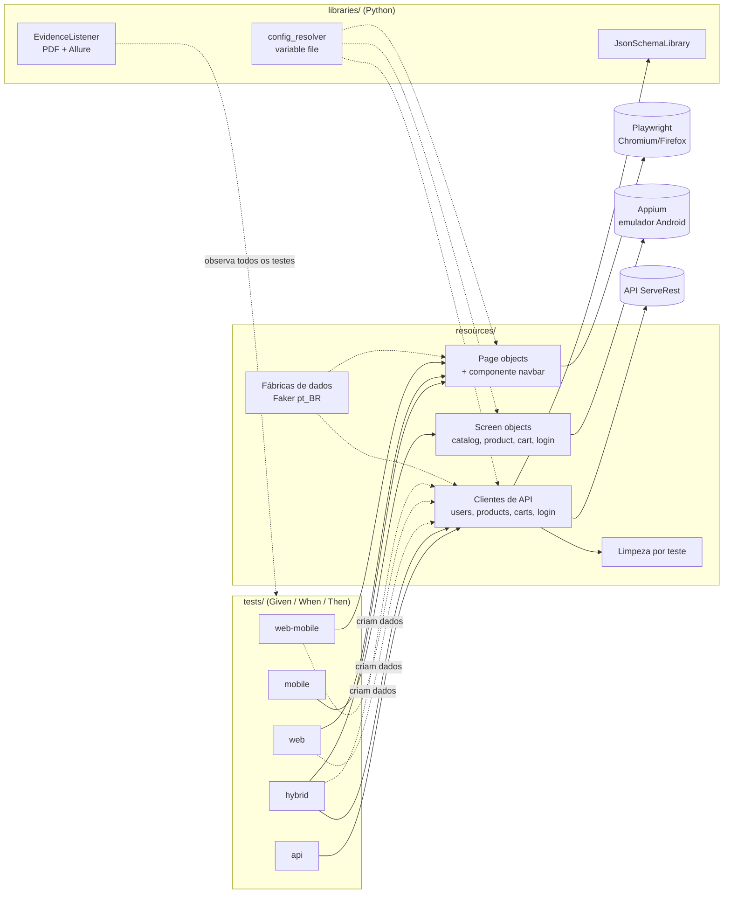

# Robot Framework Test Automation

[English](README.md) | **Português (Brasil)**

[](https://github.com/ricardho/robot-framework-test-automation/actions/workflows/tests.yml)
[](https://ricardho.github.io/robot-framework-test-automation/)


Framework de automação de testes em **Robot Framework** que cobre as camadas mais pedidas nas vagas
de QA: **API REST**, **web (desktop)**, **web mobile** (emulação de dispositivos), **híbrido API + UI**
e **Android nativo** (Appium). Os testes são escritos em Given/When/Then nativo, rodam em paralelo,
geram **evidência em PDF por teste** e publicam um relatório **Allure** no GitHub Pages, sem nenhum
segredo versionado no git.

**Relatório de testes ao vivo:** https://ricardho.github.io/robot-framework-test-automation/
(log do Robot Framework: [`/robot/log.html`](https://ricardho.github.io/robot-framework-test-automation/robot/log.html))

> Projeto irmão com a mesma arquitetura em Java (Selenium, JUnit 5, Cucumber, RestAssured):
> [selenium-java-test-automation](https://github.com/ricardho/selenium-java-test-automation)

## Sistemas testados

| Camada | Aplicação |
|---|---|
| API | [ServeRest](https://serverest.dev): usuários, login (JWT), produtos, carrinhos |
| Web / web mobile | [Front-end do ServeRest](https://front.serverest.dev): loja do cliente e área administrativa |
| Android nativo | [Sauce Labs My Demo App](https://github.com/saucelabs/my-demo-app-android) 2.3.0 |

O ServeRest tem uma API **e** um front-end sobre os mesmos dados, o que permite testes híbridos de
verdade: criar dados pela API e conferir na interface, e o caminho inverso.

## Stack

| Finalidade | Ferramenta |
|---|---|
| Linguagem / dependências | Python 3.14 + [uv](https://docs.astral.sh/uv/) (`pyproject.toml` + `uv.lock`) |
| Framework | Robot Framework 7.5, Given/When/Then nativo (sem Cucumber) |
| Web UI | [Browser Library](https://robotframework-browser.org/) (Playwright): Chromium, Firefox, WebKit |
| Web mobile | Emulação de dispositivos do Playwright (`iPhone 14`, `Pixel 7`) |
| Mobile nativo | AppiumLibrary + Appium + UiAutomator2, Screen Objects |
| API | RequestsLibrary + JSON Schema (draft 2020-12) por meio de uma pequena biblioteca Python |
| Massa de dados | FakerLibrary (`pt_BR`) |
| Paralelismo | Pabot (`--testlevelsplit`) |
| Relatórios | Log/report do Robot + Allure (`allure-robotframework`) no GitHub Pages |
| Evidências | Listener Python + fpdf2: um PDF por teste, modos `failure` / `always` / `steps` |
| Lint / formatação | Robocop |
| Segredos | `.env` (ignorado pelo git) + secrets do repositório no GitHub + Gitleaks |
| CI | GitHub Actions (+ job com emulador Android) |

## Arquitetura



```
config/
  settings.toml          valores padrão versionados, não sensíveis
  common.args            opções comuns a toda execução robot/pabot (pythonpath, listeners, saída)
libraries/
  config_resolver.py     variable file: --variable > variável de ambiente > .env > settings.toml > padrão
  ConfigLibrary.py       "Get Required Config": segredos como robot.api.types.Secret (exibidos como <secret>)
  JsonSchemaLibrary.py   "Json Should Match Schema" com $ref entre arquivos (urn:serverest:*)
  EvidenceListener.py    listener v3: screenshots, captura HTTP (mascarada), PDF, anexos no Allure
  evidence/              gerador de PDF (fpdf2) e mascaramento
resources/
  api/                   um cliente por endpoint + sessão, limpeza, conta admin do projeto
  web/                   ciclo de vida do navegador, page objects, componente navbar, login por token
  mobile/                ciclo de vida do app + screen objects
  data/                  fábricas de massa de dados
  schemas/               JSON Schemas das respostas da API
tests/
  api/ web/ web-mobile/ hybrid/ mobile/
scripts/                 scripts auxiliares (download do app Android)
.github/workflows/       pipeline de CI
```

## Decisões de projeto

- **Gherkin nativo no Robot.** Os prefixos `Given/When/Then/And` fazem parte do próprio Robot
  Framework: não há camada de Cucumber, e os steps são keywords comuns da suíte, que reutilizam page
  objects e clientes de API.
- **Camadas, não scripts.** Os testes descrevem comportamento; page/screen objects descrevem a
  interface; clientes de API encapsulam o HTTP; fábricas criam dados. **As asserções ficam nos
  testes**, nunca nos page objects.
- **Testes independentes num servidor público compartilhado.** Cada teste cria seus próprios usuários
  e produtos (dados únicos com Faker), e um registro por teste apaga exatamente o que foi criado no
  `Test Teardown`, na ordem certa (carrinhos → produtos → usuários). Qualquer subconjunto roda em
  qualquer ordem, em paralelo.
- **Sem sleeps.** A Browser Library espera automaticamente, e as asserções (`Get Text ... == ...`)
  são repetidas até o timeout configurado. Onde a aplicação renderiza de forma assíncrona (busca da
  loja), o page object espera a condição real (a lista filtrada) em vez de um tempo fixo.
- **Localizadores estáveis.** `data-testid` na web, accessibility ids / resource ids no Android
  (tirados do código-fonte do app), produtos localizados pelo nome único, nunca por índice.
- **Atalhos nos testes híbridos.** Os testes híbridos fazem login pela API e injetam o token no
  `localStorage`, pulando o formulário de login: testes ponta a ponta mais rápidos e menos instáveis.
- **Peculiaridades da API documentadas nos testes.** O ServeRest responde 400 para "não encontrado",
  cria um usuário num `PUT` para um id inexistente e responde 200 ao excluir um id inexistente: cada
  uma vira um teste explícito.
- **Defeitos conhecidos como testes.** Dois defeitos reais de responsividade do front-end do ServeRest
  (o botão do menu não abre; a loja é mais larga que a tela) são testes com as tags `known-defect` +
  `robot:skip-on-failure`: aparecem como SKIP, com o motivo, e ficam verdes sozinhos quando corrigidos.
- **Resiliência sem esconder falhas.** A sessão HTTP repete, com backoff, erros de rede e respostas
  502/503/504 (o servidor público às vezes derruba conexões), exceto o `POST`, que não é idempotente:
  os helpers de massa de dados recuperam um `POST` perdido consultando o registro antes de reenviar,
  então nada é criado em duplicidade. Asserções nunca são repetidas.
- **Robot Framework 7 moderno.** Sintaxe `VAR`, tipo `Secret` para credenciais, `TRY/FINALLY`,
  templates com argumentos embutidos, lint + formatação com Robocop no CI.

## Cobertura de testes

| Área | Suíte | Testes | Cenários |
|---|---|---|---|
| API | `tests/api/users.robot` | 10 | CRUD, e-mail duplicado, 5 campos inválidos (template), peculiaridades da API |
| API | `tests/api/login.robot` | 4 | login válido + schema, credenciais inválidas e em branco, conta admin secreta |
| API | `tests/api/products.robot` | 7 | só admin (403), sem token / token inválido (401), nome duplicado, campos inválidos, exclusão |
| API | `tests/api/carts.robot` | 7 | reserva de estoque, cancelar devolve, concluir mantém, um carrinho por usuário, regras de negócio |
| Web | `tests/web/*.robot` | 14 | login/logout, cadastro, lista de compras, cadastro e validação de produtos pelo admin |
| Web mobile | `tests/web-mobile/mobile_store.robot` | 6 | jornadas no iPhone 14 e no Pixel 7 + 2 defeitos conhecidos |
| Híbrido | `tests/hybrid/api_and_ui.robot` | 4 | consistência API → UI e UI → API, login por token |
| Android nativo | `tests/mobile/*.robot` | 8 | catálogo, contador do carrinho, totais, remoção de item, regras de login |

Tags: `api`, `web`, `web-mobile`, `hybrid`, `mobile`, `smoke`, `ios`, `android`, `known-defect`, além de uma por funcionalidade.

## Como executar os testes

Pré-requisitos: [uv](https://docs.astral.sh/uv/getting-started/installation/) e Node.js (para o Playwright).

```bash
uv sync                                   # cria a .venv com as dependências travadas
uv run rfbrowser init chromium            # navegador do Playwright para a Browser Library (só na primeira vez)
copy .env.example .env                    # Linux/macOS: cp .env.example .env  - depois preencha o segredo
```

| O quê | Comando |
|---|---|
| Tudo, exceto Android nativo, em paralelo | `uv run pabot --processes 3 --testlevelsplit -A config/common.args tests/api tests/web tests/web-mobile tests/hybrid` |
| Uma camada | `uv run robot -A config/common.args tests/api` |
| Por tag | `uv run robot -A config/common.args --include smoke tests` |
| Um teste | `uv run robot -A config/common.args --test "Customer logs in" tests/web` |
| Outro navegador / com janela | `uv run robot -A config/common.args --variable BROWSER:firefox --variable HEADLESS:false tests/web` |
| Android nativo (precisa de emulador + Appium) | `uv run python scripts/download_android_app.py` e depois `uv run robot -A config/common.args tests/mobile` |
| Validar sem executar | `uv run robot -A config/common.args --dryrun tests` |
| Lint / formatação | `uv run robocop check` / `uv run robocop format` |

O `-A config/common.args` é obrigatório: o núcleo do Robot Framework não lê o `pyproject.toml`
(o `robot.toml` é um recurso do RobotCode). Os resultados vão para `results/` (`log.html`,
`report.html`, `allure-results/`, `evidence/`); apague a pasta entre execuções para começar do zero.

### Configuração

Ordem de resolução (vale a primeira encontrada): `--variable NOME:valor` → variável de ambiente →
`.env` → `config/settings.toml` → padrão em `libraries/config_resolver.py`.

| Variável | Padrão | Observações |
|---|---|---|
| `API_BASE_URL` | `https://serverest.dev` | |
| `BASE_URL` | `https://front.serverest.dev` | |
| `BROWSER` | `chromium` | `chromium` \| `firefox` \| `webkit` (validado) |
| `HEADLESS` | `true` | |
| `TIMEOUT` | `15s` | timeout de espera e de repetição das asserções |
| `MOBILE_DEVICE_IOS` / `MOBILE_DEVICE_ANDROID` | `iPhone 14` / `Pixel 7` | nomes de dispositivos do Playwright |
| `APPIUM_URL` | `http://127.0.0.1:4723` | |
| `ANDROID_APP` | `apps/mda-2.3.0-27.apk` | baixado, nunca versionado |
| `SERVEREST_ADMIN_EMAIL` | `rf-automation.admin@example.com` | conta admin própria do projeto |
| `SERVEREST_ADMIN_PASSWORD` | **segredo, sem padrão** | |
| `EVIDENCE_MODE` | `failure` | `failure` \| `always` \| `steps` |
| `EVIDENCE_PDF` | `true` | |
| `EVIDENCE_DIR` | `results/evidence` | |

## Gestão de segredos

O código só lê a configuração e não se importa com quem a fornece (12-Factor):

| Onde | Como |
|---|---|
| Máquina do desenvolvedor | arquivo `.env` (ignorado pelo git), modelo em `.env.example` |
| CI | **secrets do repositório** no GitHub, expostos como variáveis de ambiente só ao job que precisa |
| Empresas | um cofre (HashiCorp Vault, Azure Key Vault...) alimentando as mesmas variáveis de ambiente |

Proteções:
- **Falha rápida:** um segredo ausente interrompe só os testes que precisam dele, com uma mensagem explicando como fornecê-lo.
- **Tipo `Secret`** (Robot Framework 7.4+): o valor aparece como `<secret>` no log e no report.
- **As requisições com credenciais rodam com o nível de log elevado para WARN**, para que a RequestsLibrary não as registre.
- **Mascaramento nas evidências:** valores de `password`, `authorization` e `token` (e o próprio segredo) viram `***` nos PDFs.
- **Gitleaks** varre **todo o histórico do git** antes de qualquer teste rodar no CI.

O segredo protege uma conta admin própria do projeto no ServeRest público. O servidor público expõe
senhas por design, mas a conta é tratada de propósito como um segredo real: o que importa é a prática.
A conta é recriada sob demanda, porque o servidor é reiniciado periodicamente.

## Evidências de teste

Muitas empresas (bancos, seguradoras, consultorias) exigem evidência dos testes executados para
auditoria ou homologação.

| `EVIDENCE_MODE` | Captura | PDF para |
|---|---|---|
| `failure` (padrão) | screenshot, URL e código-fonte da página (`.html`) do step que falhou | testes que falharam |
| `always` (CI) | + screenshot final | todos os testes |
| `steps` (auditoria) | + screenshot após cada step Given/When/Then | todos os testes |

```bash
uv run robot -A config/common.args --variable EVIDENCE_MODE:steps tests/web
```

Cada PDF (`results/evidence/<STATUS>_<Suite>_<Test>_<timestamp>.pdf`) tem um cabeçalho com teste,
suíte, status, início, duração e detalhes da execução (URL da aplicação/API, navegador, dispositivo,
ambiente), a mensagem de falha e os steps numerados, cada um mantido na mesma página que suas
**trocas HTTP** (com credenciais mascaradas) e seu **screenshot** (JPEG, para manter os arquivos
pequenos). Os screenshots e o PDF também são anexados ao relatório Allure. O listener nunca altera o
resultado de um teste: qualquer erro de captura só gera um aviso no log. No CI, os PDFs são enviados
como artefatos.

## CI/CD

`.github/workflows/tests.yml`, em push na `main`, pull requests, execuções manuais e dias úteis:

1. **Varredura de segredos:** Gitleaks CLI em todo o histórico.
2. **Lint:** Robocop check + verificação de formatação.
3. **Testes:** API, web, web mobile e híbridos no Chromium com Pabot, `EVIDENCE_MODE=always`.
4. **Cross-browser:** testes smoke de web e híbridos no Firefox.
5. **Android nativo** (só agendado e manual): emulador Android 14 (KVM) + Appium + UiAutomator2.
6. **Relatório:** Allure (todas as suítes) + log/report do Robot publicados no GitHub Pages, mesmo quando há falhas.

## Roadmap

- [ ] Regressão visual nas páginas da loja
- [ ] Verificações de acessibilidade (axe-core via Playwright)
- [ ] Histórico/tendências do Allure entre execuções
- [ ] Testes de contrato da API
- [ ] App iOS nativo num runner macOS
